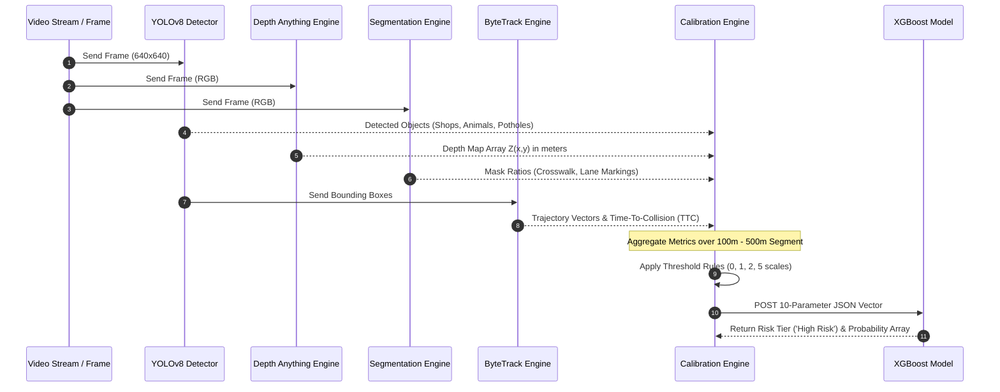
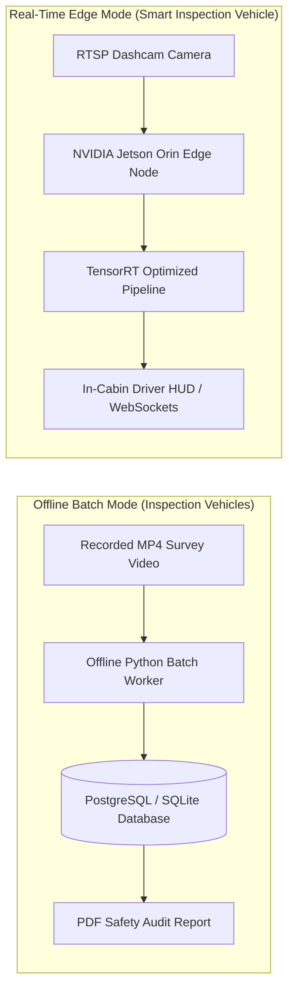
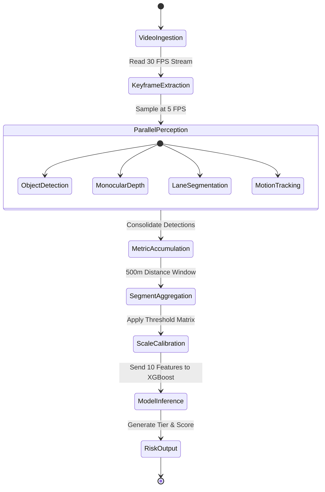

# 🏗️ System Architecture & Workflow Diagrams (`FD_v2`)

This document presents the detailed architectural blueprints, component diagrams, and data workflow pipelines for the **Phase 2 Vision-Based Automated Road Safety Analytics System**.

---

## 📐 1. End-to-End System Architecture Diagram

The high-level system components and data boundaries are illustrated below:

```mermaid
flowchart TB
    subgraph INGESTION["1. Video Ingestion & Decoding Layer"]
        A1[Dashcam / Drone Video Stream] --> A2[OpenCV Video Reader / Frame Sampler]
        A2 --> A3[Frame Preprocessing & Resizing 1080p -> 640p]
    end

    subgraph CV_LAYER["2. Multi-Task Vision Perception Layer (GPU Cluster / TensorRT)"]
        A3 --> B1[YOLOv8/v11 Object Detector]
        A3 --> B2[Depth Anything V2 Monocular Depth]
        A3 --> B3[U-Net / SAM 2 Segmentation]
        A3 --> B4[ByteTrack / DeepSORT Tracker]

        B1 --> C1[Bounding Boxes: Shops, Animals, Potholes]
        B2 --> C2[Metric Depth Map Z-Channel]
        B3 --> C3[Segmentation Masks: Lanes, Crosswalks]
        B4 --> C4[Trajectory Vectors: Pedestrians & Vehicles]
    end

    subgraph AGGREGATION["3. Spatial-Temporal Aggregation & Calibration Engine"]
        C1 & C2 & C3 & C4 --> D1[Frame-Level Metrics Extractor]
        D1 --> D2[Rolling Spatial Window Aggregator (500m Segment Buffer)]
        D2 --> D3[Empirical Threshold Calibration Engine]
        D3 --> D4[Standardized 10-Parameter JSON Payload]
    end

    subgraph INFERENCE["4. Tuned XGBoost Machine Learning Engine"]
        D4 --> E1[Feature Normalizer & Standard Scaler]
        E1 --> E2[Tuned XGBoost Classifier Engine]
        E2 --> E3[Crash Risk Category: Very Low | Low | High | Very High]
        E2 --> E4[Predicted Crash Index Score: 0.00 - 10.00]
    end

    subgraph DASHBOARD["5. Visualization & Alerting Layer"]
        E3 & E4 --> F1[Geographic GIS Risk Map / Leaflet Heatmap]
        E3 & E4 --> F2[Blackspot Alert System & Audit Generator]
    end
```

---

## 🔄 2. Frame-to-Feature Calibration Sequence Diagram

This sequence diagram illustrates how a single video frame is processed through the perception sub-systems to generate ordinal feature values:



---

## ⚡ 3. Real-Time vs. Batch Pipeline Deployment Architecture

The pipeline supports two execution modes depending on operational requirements:



---

## 🛠️ 4. Data Processing Pipeline Lifecycle



---

## 📁 Summary of Technical Component Specifications

| Layer | Primary Tech Stack | Input Data Format | Output Data Format |
| :--- | :--- | :--- | :--- |
| **Ingestion** | OpenCV / PyAV | H.264 / MP4 Video File or RTSP | BGR Numpy Arrays (1080p @ 30fps) |
| **Perception** | PyTorch / TensorRT / ONNX | BGR Images (640x640) | Bounding Boxes, Mask Bitmaps, Depth Arrays |
| **Calibration** | Python Pandas / NumPy | Visual Detection Matrices | 10-Element Ordinal Dictionary (`int64`) |
| **Inference** | XGBoost / Joblib Pipeline | Standardized Feature Matrix | Risk Class `int` & Probabilities `float` |
| **Visualization**| Streamlit / Leaflet.js / Plotly | Segment Output Dict | Interactive Maps & PDF Reports |
