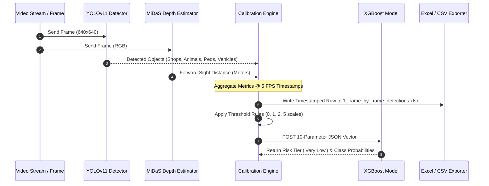

# 🏗️ System Architecture & Workflow Diagrams (`FD_v2`)

This document presents the detailed architectural blueprints, component diagrams, and data workflow pipelines for the **Phase 2 Vision-Based Automated Road Safety Analytics System**.

---

## 📐 1. End-to-End System Architecture Diagram

The high-level system components and data boundaries are illustrated below:

```mermaid
flowchart TB
    subgraph INGESTION["1. Video Ingestion & Decoding Layer"]
        A1[Dashcam / Drone Video Stream .mp4] --> A2[OpenCV Video Reader / Frame Sampler]
        A2 --> A3[Frame Preprocessing & Resizing 1080p -> 640p]
    end

    subgraph CV_LAYER["2. Multi-Task Vision Perception Layer (CUDA GPU)"]
        A3 --> B1[YOLOv11 Object Detector]
        A3 --> B2[MiDaS Monocular Depth Estimator]
        A3 --> B3[Grounded-SAM 2 Segmentation]
        A3 --> B4[ByteTrack Tracker]

        B1 --> C1[Bounding Boxes: Shops, Animals, Vehicles, Peds]
        B2 --> C2[Sight Distance Depth Map Z-Channel]
        B3 --> C3[Segmentation Masks: Crosswalks, Lane Lines]
        B4 --> C4[Trajectory Vectors: Near-Miss TTC Conflicts]
    end

    subgraph AGGREGATION["3. Spatial-Temporal Aggregation & Calibration Engine"]
        C1 & C2 & C3 & C4 --> D1[Frame-Level Metrics Extractor]
        D1 --> D2[Rolling Spatial Window Aggregator (500m Buffer)]
        D2 --> D3[Empirical Threshold Calibration Engine]
        D3 --> D4[Standardized 10-Parameter JSON & Excel Log]
    end

    subgraph INFERENCE["4. Tuned XGBoost Machine Learning Engine"]
        D4 --> E1[Feature Normalizer & Standard Scaler]
        E1 --> E2[Tuned XGBoost Classifier Engine]
        E2 --> E3["Crash Risk Category: Very Low / Low / High / Very High"]
        E2 --> E4[Predicted Crash Index Score: 0.00 - 10.00]
    end

    subgraph DASHBOARD["5. Visualization & Report Export Layer"]
        E3 & E4 --> F1[Annotated Video Output: 1_annotated.mp4]
        E3 & E4 --> F2[Frame-by-Frame Excel Log .xlsx & JSON Audit Report]
    end
```

---

## 🔄 2. Frame-to-Feature Calibration Sequence Diagram

This sequence diagram illustrates how video frames are processed through YOLOv11 and MiDaS Depth estimation to generate timestamped ordinal feature values:



---

## 🛠️ Summary of Technical Component Specifications

| Layer | Primary Tech Stack | Input Data Format | Output Data Format |
| :--- | :--- | :--- | :--- |
| **Ingestion** | OpenCV / PyAV | H.264 / MP4 Video File (`DATA/IP/*.mp4`) | BGR Numpy Arrays (1080p @ 30fps) |
| **Perception** | PyTorch / YOLOv11 / MiDaS | BGR Images (640x640) | Bounding Boxes, Class Counts, Depth Meters |
| **Calibration** | Python Pandas / NumPy | Visual Detection Matrices | 10-Element Ordinal Dictionary (`int64`) |
| **Inference** | XGBoost / Joblib Pipeline | Standardized Feature Matrix | Risk Class `string` & Probabilities `dict` |
| **Export** | OpenPyXL / Pandas / JSON | Segment Output Dict | Timestamped `.xlsx` Sheet, `.csv`, `.json`, & `.mp4` |
