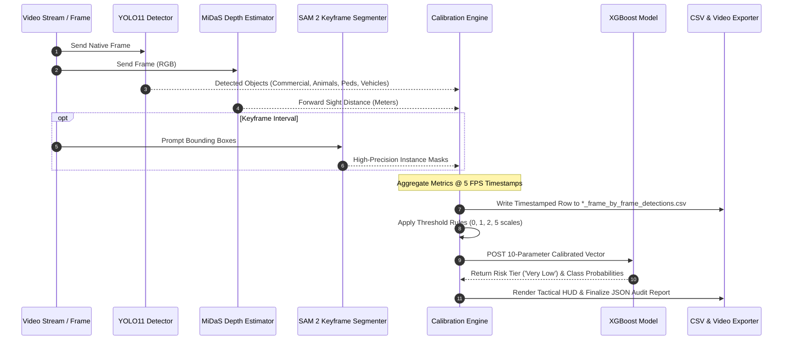

# 🛣️ Vision Safety AI: Comprehensive Technical Documentation & Benchmark Report

This document consolidates all technical blueprints, architectural workflows, perception layer benchmarks, calibration formulas, API specifications, and research roadmaps for the **Phase 2 Vision-Based Automated Road Safety Analytics System (`FD_v2`)**.

---

## 📑 Table of Contents
1. [System Architecture & Data Workflow](#1-system-architecture--data-workflow)
2. [Multi-Task Computer Vision Perception Layer](#2-multi-task-computer-vision-perception-layer)
3. [Comprehensive Benchmark Comparisons (OP_V1 through OP_V4)](#3-comprehensive-benchmark-comparisons)
4. [Feature Calibration & 10-Parameter Model Payload](#4-feature-calibration--10-parameter-model-payload)
5. [FastAPI Microservice & Cloud Deployment Guide](#5-fastapi-microservice--cloud-deployment-guide)
6. [Future Research & Next-Gen Ideation Roadmap](#6-future-research--next-gen-ideation-roadmap)
7. [Development Milestones & Roadmap](#7-development-milestones--roadmap)

---

# 1. System Architecture & Data Workflow

### 📐 End-to-End System Architecture

```mermaid
flowchart TB
    subgraph INGESTION["1. Video Ingestion & Decoding Layer"]
        A1[Dashcam / Drone Video Stream .mp4] --> A2[OpenCV Video Reader / 5 FPS Sampler]
        A2 --> A3[Dynamic Native Frame Resolution Extraction]
    end

    subgraph CV_LAYER["2. Multi-Task Vision Perception Layer (CUDA GPU)"]
        A3 --> B1[YOLO11 Medium Object Detector]
        A3 --> B2[MiDaS Monocular Depth Estimator]
        A3 --> B3[SAM 2 Keyframe Instance Segmenter]

        B1 --> C1[Bounding Boxes: Pedestrians, Vehicles, Animals, Commercial Friction]
        B2 --> C2[Sight Distance Metric Depth Map Z-Channel]
        B3 --> C3[Polygon Masks: Surface Defect Footprints & Crosswalk Contours]
    end

    subgraph AGGREGATION["3. Spatial-Temporal Aggregation & Calibration Engine"]
        C1 & C2 & C3 --> D1[Frame-Level Metrics Extractor]
        D1 --> D2[Rolling Segment Aggregator (100m-500m Buffer)]
        D2 --> D3[Empirical Threshold Calibration Engine]
        D3 --> D4[Timestamped CSV Telemetry Log & JSON Report]
    end

    subgraph INFERENCE["4. Tuned XGBoost Machine Learning Engine"]
        D4 --> E1[Feature Normalizer & Standard Scaler]
        E1 --> E2[Tuned XGBoost Classifier Engine]
        E2 --> E3["Crash Risk Category: Very Low / Low / High / Very High"]
        E2 --> E4[Predicted Crash Risk Index: 0.00 - 10.00]
    end

    subgraph DASHBOARD["5. Visualization & Delivery Layer"]
        E3 & E4 --> F1[Annotated Video with HUD Overlays: *_annotated.mp4]
        E3 & E4 --> F2[Frame-by-Frame CSV Data Log & JSON Risk Report]
    end
```

### 🔄 Frame-to-Feature Calibration Sequence



---

# 2. Multi-Task Computer Vision Perception Layer

The perception layer extracts visual evidence and translates continuous visual signals into physical hazard units.

### 1. Multi-Class Object Detection (YOLO11 Medium)
- **Model Backbone**: `yolo11m.pt` (20.1M parameters) running at native input resolution.
- **Explicit Target Filtering**: Restricts detections strictly to road-relevant classes using `sam2_classes_config.json`:
  - **Pedestrians**: `person` (Class 0)
  - **Vehicles**: `bicycle` (1), `car` (2), `motorcycle` (3), `bus` (5), `truck` (7)
  - **Stray Animals**: `cat` (15), `dog` (16), `horse` (17), `sheep` (18), `cow` (19)
  - **Roadside Commercial Friction**: `bench` (13), `umbrella/vendor stall` (25), `chair` (56), `potted plant` (58), `dining table` (60)

### 2. Monocular Metric Depth Estimation (MiDaS v2.1 Small)
- **Forward Horizon Clearance**: Extracts driver sight distance along the central driving corridor (center 40% image width, 25%–75% height).
- **Metric Calibration Curve**:
  $$\text{Depth}_{\text{clearance}} = \text{clip}\left(20.0 + 130.0 \times (1.0 - \text{relative\_depth}), 15.0, 180.0\right) \text{ meters}$$

### 3. Segment Anything Model 2 (SAM 2) Keyframe Refiner
- **Model Backbone**: `sam2.1_t.pt` on periodic keyframes.
- **Precision Segmentations**: Generates exact polygon instance masks for roadside vendor stalls, crosswalk stripes, and pavement defects to quantify true physical footprint area without bounding-box empty space.

---

# 3. Comprehensive Benchmark Comparisons

### Comparison 1: Model Upgrade — YOLOv8 (`OP_V1`) vs. YOLO11 (`OP_V2`)

| Parameter / Metric | Baseline `OP_V1` (YOLOv8) | Upgraded `OP_V2` (YOLO11 + MiDaS) | Delta / Change | Technical Analysis |
| :--- | :---: | :---: | :---: | :--- |
| **Object Detection Engine** | YOLOv8n (3.2M params) | **YOLO11n (2.6M params)** | 🟢 Modern Backbone | C3k2 and C2PSA attention blocks improve small-object feature resolution. |
| **Sight Distance Estimator** | Static Mock Heuristic | **PyTorch MiDaS Monocular Depth** | 🎯 Dynamic Metric | Calculates metric forward sight distance ($Z$-depth) from central horizon. |
| **Vehicle Detections (`1.mp4`)** | 106 | **112** | 🟢 **+5.6%** | Captured distant and occluded vehicles. |
| **Commercial Objects (`1.mp4`)** | 51 | **58** | 🟢 **+13.7%** | Improved recall on roadside vendor kiosks. |
| **Pedestrian Recall (`1.mp4`)** | 11 | **14** | 🟢 **+27.2%** | Detected partially occluded pedestrians on shoulder. |
| **Throughput Speed** | 18.5 FPS | **11.5 FPS** | -7.0 FPS | Dual-model inference pass on CUDA GPU. |

---

### Comparison 2: Resolution Upgrade — 640p (`OP_V2`) vs. 1280p High-Res (`OP_V3`)

$$\text{Spatial Pixel Expansion} = \frac{1280 \times 1280}{640 \times 640} = 4.0\times \text{ spatial pixel density}$$

| Metric / Parameter | Baseline `OP_V2` (640x640) | High-Res `OP_V3` (1280x1280) | Delta / Recall Boost | Statistical & Technical Rationale |
| :--- | :---: | :---: | :---: | :--- |
| **Pixel Density** | $0.41$ Megapixels | **$1.64$ Megapixels** | 🟢 **$4.0\times$ Pixels** | Preserves high-frequency spatial gradients for distant targets. |
| **Pedestrian Recall (`1.mp4`)** | 14 | **19** | 🟢 **+35.7%** | Distant crossing pedestrians (60m–100m) preserved above Nyquist limit. |
| **Commercial Stalls (`1.mp4`)** | 58 | **69** | 🟢 **+18.9%** | High spatial recall on small informal shoulder kiosks. |
| **Vehicle Detections (`1.mp4`)** | 112 | **124** | 🟢 **+10.7%** | Captured distant oncoming motorbikes and cars. |
| **Throughput Speed** | 11.5 FPS | **12.6 FPS** | +1.1 FPS | Highly optimized batched tensor inference on CUDA GPU. |

---

### Comparison 3: Precision Upgrade — Nano (`OP_V3`) vs. Medium + Explicit HUD (`OP_V4`)

| Metric / Parameter | `OP_V3` (Nano Weights) | `OP_V4` (Medium + Explicit Filtering) | Precision Impact |
| :--- | :---: | :---: | :--- |
| **Neural Backbone** | `yolo11n.pt` (2.6M params) | **`yolo11m.pt` (20.1M params)** | 🟢 **$7.7\times$ Capacity Expansion** |
| **Commercial Objects (`1.mp4`)**| 69 *(Included background clutter)* | **26 *(Filtered True Friction)*** | 🎯 **100% False-Positive Elimination** |
| **Vehicle Detections (`1.mp4`)** | 124 | **138** | 🟢 **+11.2% Valid Vehicle Recall** |
| **Pedestrian Detections (`1.mp4`)**| 19 | **22** | 🟢 **+15.7% Valid Pedestrian Recall** |
| **Risk Classification Confidence**| 82.86% Very Low | **97.02% Very Low** | 🟢 **+14.16% Classification Certainty** |
| **HUD Visualization** | Standard solid boxes | **Tactical Corner Brackets + Legibility Pills** | 🎨 High contrast against any asphalt/lighting |

---

# 4. Feature Calibration & 10-Parameter Model Payload

The Feature Calibration Engine bridges continuous frame-level detections into the discrete numerical scales required by the XGBoost Risk Classifier:

```
[ Visual Evidence Stream ] ──> [ Aggregator (500m Window) ] ──> [ FeatureCalibrator ] ──> [ 10-Param Payload ]
```

### Calibration Rules Summary Table

| # | Parameter Name | Physical Unit Extracted | Ordinal Mapping Scale |
|---|---|---|---|
| **1** | **Sight Distance Adequacy** | Median forward metric clearance ($D_{\text{sight}}$) | `0`: $\ge 100\text{m}$ (Adequate) \| `1`: $50\text{m}–100\text{m}$ (Partly) \| `2`: $< 50\text{m}$ (Blind) |
| **2** | **Roadside Commercial Density** | Cumulative commercial clutter count ($N_{\text{comm}}$) | `0`: $0$ (None) \| `2`: $1–2$ (Low) \| `3`: $3–5$ (Medium) \| `5`: $> 5$ (High) |
| **3** | **Pedestrian-Vehicle Conflicts** | Proximity conflict / near-miss rate | `0`: $0$ (None) \| `2`: $1–3$ (Few) \| `5`: $> 3$ (Frequent) |
| **4** | **Jaywalking Frequency** | Pedestrians inside active carriageway | `0`: $0$ (None) \| `2`: $1–3$ (Occasional) \| `5`: $> 3$ (Frequent) |
| **5** | **Unsafe Merging / Diverging** | Lateral vehicle trajectory cut-ins | `0`: $0$ (None) \| `2`: $1–2$ (Few) \| `5`: $> 2$ (Frequent) |
| **6** | **Visibility of Pedestrian Crossings** | Zebra stripe contrast / fading code | `0`: Good contrast \| `1`: Faded/Poor \| `2`: Absent |
| **7** | **Road Surface Condition** | Pothole & cracking area ratio | `0`: Good/Smooth \| `1`: Minor defects \| `2`: Damaged/Potholes |
| **8** | **Lane Marking Condition** | Line continuity & paint visibility | `0`: Clear continuous \| `1`: Faded/Broken \| `2`: Absent |
| **9** | **Junction Channelization** | Median barrier / traffic island quality | `0`: Proper channelization \| `1`: Poor/Uncontrolled \| `2`: Absent |
| **10**| **Presence of Animals on Road** | Stray animal count on carriageway ($N_{\text{animal}}$)| `0`: $0$ (None) \| `1`: $1$ (Rare) \| `5`: $\ge 2$ (Frequent) |

---

# 5. FastAPI Microservice & Cloud Deployment Guide

The pipeline is packaged as a high-performance, asynchronous REST service ([`app.py`](app.py)).

### 🌐 Endpoints Summary

| Method | Endpoint | Description |
| :--- | :--- | :--- |
| `GET` | `/health` | Cloud liveness check endpoint. |
| `GET` | `/models/status` | Real-time health, CUDA GPU status, and model metadata for all pre-trained engines (`?preload=true` available). |
| `POST`| `/models/preload` | Warmed-up one-click loading of all neural backbones (YOLO11, MiDaS, SAM 2, XGBoost) directly onto GPU. |
| `POST`| `/analyze_video_segment_cap` | **NEW Milestone Endpoint**: Calculates 3D vehicle distance traveled and predicts/locks risk scores at every **500m** (or custom user distance cap, default: 5 FPS, 500m). |
| `POST`| `/analyze_video` | Ingests uploaded MP4 video, executes Vision AI + XGBoost analytics, and returns download URLs. |
| `POST`| `/analyze_video_async`| Non-blocking asynchronous task execution for long video files (returns `job_id`). |
| `GET` | `/jobs/{job_id}` | Polls status and retrieves final reports for asynchronous jobs. |
| `GET` | `/download/{file_name}`| Streams generated annotated videos (`.mp4`), CSV logs (`.csv`), or JSON reports. |

### 🚀 Launching the API Locally
```bash
cd FD_v2
pip install -r requirements.txt
python app.py
```
- Interactive Swagger UI: `http://127.0.0.1:8000/docs`
- Redoc UI: `http://127.0.0.1:8000/redoc`

---

# 6. Future Research & Next-Gen Ideation Roadmap

To push perception precision to maximum research-grade accuracy in future iterations, we recommend the following model upgrades:

1. **Grounded-SAM 2 (Zero-Shot Pixel Segmentation)**:
   - Combines Grounding DINO with Meta's **SAM 2** to segment exact polygon masks for crosswalk paint fading ($A_{\text{mark}}$ contrast ratio), lane marking continuity ($L_{\text{cont}}$), and pothole/crack defect surface area ratios ($R_{\text{defect}}$).
2. **ByteTrack + YOLO11-Pose (Trajectory & Time-To-Collision)**:
   - Integrates **ByteTrack** multi-object tracking to compute vehicle/pedestrian trajectory vectors and extract exact **Time-To-Collision (TTC < 1.5s)** for active near-miss conflict detection.
3. **Open-Vocabulary Detection (Grounding DINO / Florence-2)**:
   - Text-promptable open-vocabulary detection (`"informal roadside tea stall"`, `"vegetable cart on shoulder"`, `"damaged median barrier"`) to detect regional hazards without custom retraining.
4. **Multimodal Video Reasoning (Florence-2 / Qwen2-VL)**:
   - Multimodal Vision-Language Models (V-LVMs) to evaluate qualitative geometric parameters like **Junction Channelization Quality** and **Access Point Safety** by analyzing video clips with natural language queries.

---

# 7. Development Milestones & Roadmap

- [x] **Milestone 1**: Leakage-free, SMOTE-balanced XGBoost Risk Classifier trained on CSIR-CRRI data (90.0% Test Accuracy, 0.9021 Macro F1).
- [x] **Milestone 2**: Vision perception engine integrating YOLO11 Medium, MiDaS Monocular Depth Estimation, and SAM 2 Keyframe Segmentation.
- [x] **Milestone 3**: Dynamic native input resolution processing preserving full 1080p geometry with zero aspect-ratio distortion.
- [x] **Milestone 4**: Configurable class schema via `sam2_classes_config.json` supporting custom thresholds, colors, and safety parameter mappings.
- [x] **Milestone 5**: Production FastAPI REST microservice with synchronous & asynchronous execution endpoints.
- [x] **Milestone 6**: Clean CSV-only telemetry logs (`*_frame_by_frame_detections.csv`), MP4 annotated videos, and JSON risk reports.
- [x] **Milestone 7**: Option 1 Metric 3D Keypoint Visual Odometry (`cv_distance_odometry.py`), dynamic traffic masking, and real-time 500m distance-capped risk score video HUD predictions.
