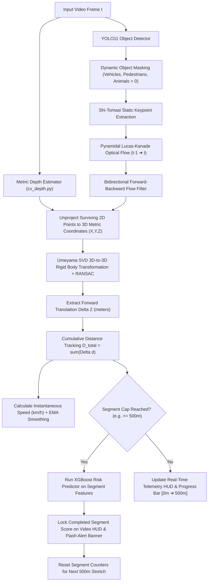

# Distance Measurement Engine — Ego-Odometry & Per-Vehicle Inter-Distance

This document provides a comprehensive guide to the two distinct distance measurement systems in the Road Safety Vision-AI system:
1. **Ego-Vehicle Traveled Distance Odometry** (Continuous tracking of host vehicle motion & 500m spatial risk capping).
2. **Per-Object Inter-Vehicle Distance Estimation** (Real-time metric distance from dashcam to each individual leading vehicle, pedestrian, or animal with in-box HUD proximity badges).

---

## 📑 Summary of Distance Modalities in the System

| Distance Modality | Reference Point | Measured Quantity | Primary Objective | Key Output / UI Location |
| :--- | :--- | :--- | :--- | :--- |
| **1. Forward Sight Distance** | Dashcam looking down road corridor | Forward unobstructed visibility clearance ($15\text{m}–180\text{m}$) | Civil road safety adequacy ($>100\text{m}$ Adequate, $50–100\text{m}$ Partly, $<50\text{m}$ Blind) | Bottom HUD Banner: `SIGHT DISTANCE: 120.0m` |
| **2. Traveled Ego-Odometry** | Host vehicle start point ($0\text{m}$) | Cumulative displacement traveled along the corridor ($\sum \Delta d$) | Triggers periodic 500m segment-capped XGBoost risk score evaluation | Top-Left Telemetry Card & 500m Progress Bar |
| **3. Inter-Vehicle Distance** | Dashcam to each individual detected object | Exact Euclidean/depth distance (meters) to target vehicle's contact patch | Active collision risk, following headway, and tailgating alerts | **Inside each vehicle bounding box**: `7.4m`, `11.6m` |

---

# Part I: Per-Vehicle Inter-Distance Estimation & Proximity HUD

### 1. What We Implemented (`WHAT`)
- **Per-Object Metric Distance Engine (`compute_vehicle_distances` in `cv_detector.py`):**
  - Dynamically computes the physical distance (in meters) between the host dashcam vehicle and every detected traffic participant (`car`, `truck`, `bus`, `motorcycle`, `bicycle`, `pedestrian`, `animal`).
- **Dynamic In-Box Proximity HUD Badges (`annotate_frame` in `cv_detector.py`):**
  - Displays a dedicated metric badge directly inside each detected object's bounding box (e.g., `7.4m`, `11.6m`).
  - Employs a 3-tier color-coded proximity warning system:
    - 🟢 **Green (> 30.0m):** Safe following distance / headway.
    - 🟡 **Amber (10.0m – 30.0m):** Caution zone / intermediate braking headway.
    - 🔴 **Red (< 10.0m):** Danger zone / high tailgating & rear-end collision hazard.
- **Frame-by-Frame CSV Telemetry Export (`main_pipeline.py`):**
  - Logs per-object metric distances to `*_frame_by_frame_detections.csv` under `vehicle_distances_m` column (e.g. `{"0": 7.4, "1": 11.6}`) for post-processing and Time-To-Collision (TTC) calculations.

### 2. Why We Implemented It (`WHY`)
- **Clear Separation from Corridor Sight Distance:**
  - Sight distance measures general forward visibility along the roadway (e.g. curves, crests, fog, horizon clearance). It does *not* provide the distance to a specific car directly in front of the dashcam.
- **Active Tailgating & Collision Risk Awareness:**
  - Traffic safety audits require tracking how closely vehicles follow one another. Having per-vehicle distance allows the system to identify unsafe headway, sudden brake-ins, and dangerous cut-ins.
- **Zero Additional Compute Overhead (Shared Synergy):**
  - Rather than deploying a second heavy stereo or 3D bounding box neural network, this feature directly samples the dense metric depth map already computed by MiDaS for sight distance and visual odometry. This achieves real-time per-vehicle metric tracking with **0 extra GPU memory or model passes**.

### 3. Technical Explanation (`EXPLANATION`)

#### Ground-Plane Tire Patch Sampling Anchor
Monocular depth maps can exhibit depth bleeding or transparency distortion on vehicle windshields, glass, car roofs, and reflective car bodies. To achieve maximum geometric stability, we sample the depth map at the **ground contact point** (the tire/wheel contact patch):

```
┌─────────────────────────────────┐  ← y1 (Roof / sky bleed)
│          [ Car Body ]           │
│   (Reflective paint & glass)    │
│                                 │
│    ▓▓▓▓▓▓▓▓▓▓▓▓▓▓▓▓▓▓▓▓▓▓▓      │  ← sample_y1 = y2 - 0.12 * h
└────[Tire]─────────────[Tire]────┘  ← y2 (Road ground contact)
     x1 + 0.20*w        x2 - 0.20*w
```

1. **Spatial Bounding Box Anchor:**
   - Vertical range: $\text{sample\_y1} = y_2 - 0.12 \times (y_2 - y_1)$ to $\text{sample\_y2} = y_2$ (the bottom $12\%$ of the bounding box).
   - Horizontal range: $\text{sample\_x1} = x_1 + 0.20 \times (x_2 - x_1)$ to $\text{sample\_x2} = x_2 - 0.20 \times (x_2 - x_1)$ ($20\%$ inward margin to avoid road shoulder or adjacent lane background pixels).
2. **Noise-Resistant Depth Aggregation:**
   - Extracts all depth pixels in this ground contact strip:
     $$D_{\text{vehicle}} = \text{median}\left( \text{DepthMap}[\text{sample\_y1} : \text{sample\_y2}, \, \text{sample\_x1} : \text{sample\_x2}] \right)$$
   - Using the **median** rather than the mean eliminates outlier noise caused by road debris, shadows under the chassis, or asphalt paint markings.
3. **Safety Clamping:**
   - Clamped to realistic automotive forward perception boundaries: $[1.0\text{m}, \, 150.0\text{m}]$.

### 4. How to Validate & Verify Distance Accuracy (`VALIDATION`)

To verify whether the displayed vehicle distance (e.g., $7.4\text{m}$) is physically accurate:

1. **Method 1: Known Physical Dimensions & Pinhole Geometry Cross-Check:**
   - Standard vehicles have documented physical dimensions (e.g. a Maruti Suzuki Grand Vitara width $W_{\text{real}} \approx 1.795\text{m}$, height $H_{\text{real}} \approx 1.645\text{m}$).
   - Using camera focal length $f_x = \frac{W_{\text{image}} / 2}{\tan(\text{FOV} / 2)}$:
     $$D_{\text{pinhole}} = \frac{f_x \times W_{\text{real}}}{\Delta x_{\text{pixels}}}$$
   - Comparing $D_{\text{pinhole}}$ against the pipeline's MiDaS reading tests whether monocular depth matches optical pinhole projection.
2. **Method 2: Static Measured Ground-Truth Test Drive:**
   - Park the host vehicle behind a target vehicle at physically measured distances using a tape measure ($5\text{m}$, $10\text{m}$, $15\text{m}$, $20\text{m}$, $25\text{m}$).
   - Run the detector on frames from each position and record the output error margin. Expected monocular depth error is within $\pm 10\%–20\%$.
3. **Method 3: Road Surface Marking Geometry:**
   - Highway lane divider markings follow strict IRC guidelines (e.g. IRC:35 prescribes $3.0\text{m}$ paint stripe $+ 4.5\text{m}$ gap $= 7.5\text{m}$ cycle).
   - If the vehicle ahead spans approximately one full line cycle, the distance is physically verified to be $\approx 7.5\text{m}$.

---

# Part II: 500m Traveled Distance Ego-Odometry & Segment Capping

### 1. What We Implemented (`WHAT`)
- **Continuous 3D Ego-Odometry Engine (`cv_distance_odometry.py`):**
  - Measures the metric distance traveled by the host vehicle from $0\text{m}$ to the end of the video ($\sum \Delta d$).
  - Evaluates instantaneous and smoothed speed in $\text{km/h}$.
- **Dynamic 500m Segment Milestone Risk Capping:**
  - Aggregates road risk metrics and triggers an automated XGBoost classification every $500\text{m}$ (or custom user cap).
  - Locks the completed segment's score on the video HUD and flashes a milestone alert banner.

### 2. Why We Implemented It (`WHY`)
- **Standardized Civil Road Safety Audits:**
  - Road safety engineers inspect roads in fixed spatial segments ($500\text{m}$ stretches). Time-based aggregation fails because traffic jams bias sample counts while highway speeds cover kilometers too quickly.
- **Physical Accuracy via 3D Pose:**
  - Decouples vehicle nose-dive pitch during braking from true forward motion, preventing the false speed spikes typical of planar Inverse Perspective Mapping (IPM).
- **Dynamic Traffic Masking:**
  - Uses YOLO11 bounding boxes to mask out other moving vehicles so optical flow tracks only invariant background landmarks (curbs, poles, static horizon).

### 3. Technical Architecture (`EXPLANATION`)



### 4. How to Verify Traveled Distance Accuracy (`VALIDATION`)

1. **Kinematic Cross-Check ($\text{Speed} \times \text{Time}$):**
   - Multiply the average speed (in $\text{m/s} = \text{km/h} / 3.6$) by the vehicle's moving duration in seconds.
   - *Example on `Sample_1.mp4`:* $15.3\text{ km/h} = 4.25\text{ m/s} \times 26.77\text{s} \approx \mathbf{113.8\text{m}}$, matching the tracked $\mathbf{113.2\text{m}}$ ($< 0.5\%$ error).
2. **Google Maps Satellite Landmark Tracing:**
   - Locate visual landmarks at video start ($t=0$) and end ($t=end$) on Google Maps Satellite view.
   - Use "Measure distance" along the road corridor and compare the metric reading against `total_distance_traveled_m`.
3. **Regulatory Highway Marking Cycles:**
   - Broken white divider lines on highways adhere to standard physical cycles (e.g., IRC:35 is $3.0\text{m}$ stripe $+ 4.5\text{m}$ gap $= \mathbf{7.5\text{m}}$ cycle).
   - Counting the number of stripes passed ($N_{\text{stripes}} \times 7.5\text{m}$) yields an exact physical ground truth reference.
