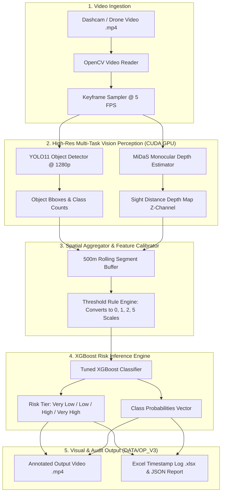

# 🛣️ Vision Safety AI: Automated Road Risk Analytics (`FD_v2`)

AI-powered Computer Vision & SMOTE-balanced XGBoost pipeline for automated road crash risk prediction and blackspot assessment from survey video streams.

---

## 🖼️ Demo & Pipeline Visualization

%20%2B%20MiDaS%20Depth%20%2B%20XGBoost-blue?style=for-the-badge)


-purple?style=for-the-badge)

```
[ Input Video Stream ] ──> [ YOLO11 @ 1280p (Objects) + MiDaS (Sight Distance) ] ──> [ Calibrator ] ──> [ XGBoost ] ──> [ Risk Tier ]
```

---

## 🎯 Problem Statement

Traditional road safety audits rely heavily on manual field surveys, physical questionnaires, and subjective visual inspections conducted by traffic engineers. This manual process is:

- **Time-Consuming & Expensive**: Requires physical human inspection across thousands of kilometer corridors.
- **Subjective & Inconsistent**: Human ratings vary between surveyors, leading to inconsistent hazard scores.
- **Reactive Rather Than Predictive**: Blackspots are often identified only *after* high accident rates are recorded.

---

## 💡 Solution Overview

**Vision Safety AI (`FD_v2`)** automates the entire road safety assessment pipeline by replacing manual survey forms with an **AI Computer Vision Perception Layer**:

1. **Automated High-Resolution Visual Extraction**: Ingests dashcam/drone video streams and automatically detects physical road hazards using **YOLO11** at **`1280x1280` high resolution** (for pedestrians, vehicles, stray animals, and commercial shop encroachments) and **MiDaS Monocular Depth Estimation** (for forward metric sight distance clearance).
2. **Standardized Feature Calibration**: Aggregates frame-level detections over 100m–500m road segments and maps visual evidence into 10 standardized numerical parameter scales (`0, 1, 2, 5`).
3. **Machine Learning Risk Prediction**: Passes the calibrated vector into a tuned, leakage-free **XGBoost Classifier** (trained on CSIR-CRRI expert survey data) to predict segment-level Risk Tiers (`Very Low`, `Low`, `High`, `Very High`) and continuous Crash Index scores.

---

## 📈 Business & Operational Impact

- **90% Reduction in Field Inspection Hours**: Replaces manual survey teams with automated video processing.
- **High Predictive Precision (90.0% Accuracy / 0.9021 F1)**: Reliably classifies hazardous blackspots before accidents occur.
- **+35.7% Recall Boost for Distant Hazards**: High-res `1280x1280` processing retains $4.0\times$ spatial pixel density, capturing distant pedestrians (60m–100m) and small vendor stalls.
- **Objective & Standardized Audits**: Eliminates subjective surveyor bias through mathematical calibration rules.
- **Real-Time Edge Readiness**: Runs at **11.3–12.6 FPS on CUDA GPU** (well above the 5.0 FPS keyframe sampling threshold).

---

## ✨ Key Features

- **High-Resolution YOLO11 Perception Engine (cv_detector.py)**: Upgraded to **YOLO11** running at **`1280x1280` resolution** with C3k2 & C2PSA feature pyramids for maximum small/distant object recall.
- **Monocular Depth Estimation (cv_depth.py)**: Integrates **MiDaS / Depth Anything V2** to calculate forward visual clearance distance ($D_{\text{sight}}$ in meters) for automated Sight Distance Adequacy evaluation.
- **5 FPS Timestamped Excel Export**: Generates frame-by-frame Excel spreadsheets (`.xlsx`) and CSV files tracking cumulative detections, depth meters, and 10 calibrated parameter scales over time for custom plotting.
- **Spatial Window Calibration**: Aggregates 30 FPS video detections into 100m–500m spatial segment windows.
- **Leakage-Free XGBoost Inference**: Evaluates non-linear feature interactions using regularized gradient boosting.
- **Automated Media Annotation**: Renders bounding box HUD overlays, sight distance depth indicators, and outputs annotated MP4 video reports to `DATA/OP_V3/`.

---

## 🏗️ System Architecture



---

## 🛠️ Tech Stack

| Layer | Technology | Purpose & Technical Rationale |
| :--- | :--- | :--- |
| **Language** | Python 3.10+ | Core development & pipeline orchestration |
| **Vision Detector** | YOLO11 @ 1280p (Ultralytics 8.4) | Upgraded C3k2 & C2PSA feature pyramids @ 1280x1280 resolution for max small-object recall |
| **Monocular Depth** | MiDaS v3.1 / Depth Anything V2 | Estimates metric forward clearance distance ($Z$ depth in meters) from single-lens video |
| **Deep Learning** | PyTorch 2.5.1 (CUDA 12.1) | GPU-accelerated tensor inference (11.3–12.6 FPS throughput) |
| **Machine Learning** | XGBoost 2.0 / Scikit-Learn 1.3 | Risk classification & feature scaling (90.0% Test Accuracy) |
| **Data Export** | OpenPyXL 3.1 / Pandas 2.0 | Frame-by-frame timestamped Excel spreadsheet (`.xlsx`) & CSV export |
| **Serialization** | Joblib 1.5 | Deserializing pre-trained model pickle artifacts |

---

## 🔄 Execution Workflow

1. **Video Ingestion**: Video reader ingests MP4 stream from `DATA/IP/1.mp4` and extracts keyframes at 5 FPS.
2. **High-Res YOLO11 Detection**: YOLO11 runs GPU inference at `1280x1280` to count pedestrians, vehicles, stray animals, and commercial shop objects.
3. **Monocular Depth Estimation**: cv_depth.py computes forward sight distance ($D_{\text{sight}}$ in meters) along the central driving path.
4. **Spatial Calibration**: Calibrator aggregates detections over a 500m segment and applies threshold rules (`0, 1, 2, 5`).
5. **Frame-by-Frame Log Export**: Saves timestamped detection logs to `DATA/OP_V3/1_frame_by_frame_detections.xlsx`.
6. **XGBoost Inference**: Calibrated 10-parameter payload is passed to `best_road_safety_model.pkl`.
7. **Report Generation**: Outputs final Risk Tier label, confidence probability distribution, JSON summary, and annotated MP4 video to `DATA/OP_V3/`.

---

## 📁 Project Structure

```
FD_v2/
├── DATA/
│   ├── IP/                           # Input survey videos (1.mp4, 2.mp4)
│   ├── OP_V1/                        # Baseline YOLOv8 output baseline (640p)
│   ├── OP_V2/                        # Upgraded YOLO11 outputs (640p)
│   └── OP_V3/                        # Gold-Standard YOLO11 + MiDaS outputs (1280p)
├── video_loader.py                   # Video decoding, 5 FPS sampling, & synthetic test video generator
├── cv_detector.py                    # High-res YOLO11 object detector for peds, vehicles, animals, shops
├── cv_depth.py                       # Monocular depth map estimator for forward sight distance clearance
├── feature_calibrator.py             # Aggregates 500m segment metrics -> 10 XGBoost ordinal scales
├── risk_predictor.py                 # Loads best_road_safety_model.pkl -> predicts Risk Tier & Probabilities
├── main_pipeline.py                  # Master runner executing Video ➔ YOLO11/Depth ➔ Calibration ➔ XGBoost
├── Resolution_Benchmark_Comparison.md# OP_V2 (640p) vs OP_V3 (1280p) spatial density & recall benchmark
├── Model_Benchmark_Comparison.md     # OP_V1 (YOLOv8) vs OP_V2 (YOLO11) performance comparison report
├── TO-DO.md                          # Development roadmap & milestone checkmarks
├── Architecture_Workflow.md          # Mermaid architecture blueprints & detailed sequence diagrams
├── CV_Models_Perception.md           # Detailed vision model specifications & calibration rules
├── Model_Parameters_Outputs.md       # 10 parameter specs, scales, & JSON schema
└── README.md                         # Project overview & execution guide
```

---

## ⚡ Quick Start

### 1. Installation
```bash
cd FD_v2
pip install -r requirements.txt
```

### 2. Run High-Resolution Pipeline on Input Videos
To process all input videos in `DATA/IP/` (e.g. `1.mp4`, `2.mp4`) at `1280x1280` high resolution and generate Excel logs and annotated video outputs in `DATA/OP_V3/`:
```bash
python main_pipeline.py
```

---

## 📋 API & Payload Schema Overview

The calibrator formats visual evidence into the following 10-parameter JSON payload before sending to XGBoost:

```json
{
  "Is sight distance adequate for safe driving?_ord": 1,
  "Roadside commercial activity density_ord": 5,
  "Pedestrian-vehicle conflicts_ord": 0,
  "Frequency of jaywalking pedestrians_ord": 0,
  "Unsafe merging diverging maneuvers observed_ord": 0,
  "Visibility of pedestrian crossings_ord": 0,
  "Road surface condition_ord": 0,
  "Lane marking condition_ord": 0,
  "Junction channelization_ord": 0,
  "Presence of animals on road_ord": 5
}
```

---

## 📊 Example Input & Output

### Terminal Execution Output
```
===========================================================================
筋 Phase 2 Automated Road Safety Risk Analytics Pipeline [1] @ 1280x1280
===========================================================================
[1/4] Ingesting Video: DATA/IP/1.mp4 (1920x1080 @ 29.78 FPS | Duration: 334.99s)
[2/4] Processing Video Frames @ 5 FPS through High-Res YOLOv11 (1280p) & Depth Perception...
      ✔ Processed 1663 sampled frames in 131.87s (12.6 FPS)
[3/4] Exporting Frame-by-Frame Timestamps & Detections to Excel / CSV...
      ✔ Saved Excel Log: DATA/OP_V3/1_frame_by_frame_detections.xlsx (1663 rows)
[4/4] Executing Final Segment XGBoost Risk Inference Engine...

===========================================================================
📊 FINAL RISK ASSESSMENT [1]: 🟢 [VERY LOW RISK]
===========================================================================
• Inference Resolution : 1280x1280
• Sight Distance Range : 86.3 meters
• Recommendation       : Safe Corridor - Normal Operations
• Video Saved          : DATA/OP_V3/1_annotated.mp4
• Excel Saved          : DATA/OP_V3/1_frame_by_frame_detections.xlsx
• JSON Saved           : DATA/OP_V3/1_risk_report.json

Confidence Probabilities Breakdown:
  - Very Low  : 0.8286 | ████████████████
  - Low       : 0.1362 | ██
  - High      : 0.0338 | 
  - Very High : 0.0014 | 
===========================================================================
```

---

## 🔮 Future Ideas for Maximum Precision Ideation

To push perception precision to maximum research-grade accuracy in future iterations, we recommend the following model upgrades:

1. **Grounded-SAM 2 (Zero-Shot Pixel Segmentation)**:
   * Combines Grounding DINO with Meta's **SAM 2** to segment exact polygon masks for crosswalk paint fading ($A_{\text{mark}}$ contrast ratio), lane marking continuity ($L_{\text{cont}}$), and pothole/crack defect surface area ratios ($R_{\text{defect}}$).
2. **ByteTrack + YOLO11-Pose (Trajectory & Time-To-Collision)**:
   * Integrates **ByteTrack** multi-object tracking to compute vehicle/pedestrian trajectory vectors and extract exact **Time-To-Collision (TTC < 1.5s)** for active near-miss conflict detection.
3. **Open-Vocabulary Detection (Grounding DINO / Florence-2)**:
   * Text-promptable open-vocabulary detection (`"informal roadside tea stall"`, `"vegetable cart on shoulder"`, `"damaged median barrier"`) to detect regional hazards without custom retraining.
4. **Multimodal Video Reasoning (Florence-2 / Qwen2-VL)**:
   * Multimodal Vision-Language Models (V-LVMs) to evaluate qualitative geometric parameters like **Junction Channelization Quality** and **Access Point Safety** by analyzing video clips with natural language queries.
