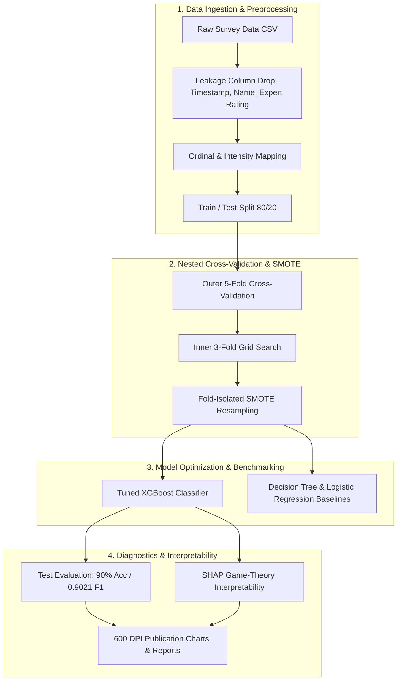

# 🛣️ Road Safety Risk Analytics: Leakage-Free XGBoost Pipeline (`Final_Draft`)

Leakage-free, SMOTE-balanced machine learning pipeline for road crash risk classification and safety index prediction developed for **CSIR-CRRI**.

---

## 🖼️ Pipeline Badges & Visual Overview


```
[ Raw Survey Data ] ──> [ Leakage Drop ] ──> [ Nested CV + Fold SMOTE ] ──> [ Tuned XGBoost ] ──> [ Risk Tier (90% Acc) ]
```

---

## 🎯 Problem Statement

Traditional machine learning implementations for road safety prediction frequently suffer from critical methodological flaws:

- **Target & Identifier Data Leakage**: Including survey metadata (e.g. timestamps, surveyor IDs, or target-derived ratings) during scaling and feature selection corrupts validation scores.
- **Minority Risk Class Collapse**: High-risk road blackspots constitute a small minority of survey data. Without strict balancing, standard classifiers collapse and fail to detect critical high-hazard segments.
- **Overfitting & Suspicious Accuracy**: Models like Random Forest often achieve artificial 100% test accuracy on small datasets due to data memorization rather than true generalization.

---

## 💡 Solution Overview

**`Final_Draft`** delivers an end-to-end, scientifically defensible machine learning pipeline that predicts road safety risk tiers (`Very Low`, `Low`, `High`, `Very High`) and continuous crash index scores (`0.00 – 10.00`):

1. **Strict Leakage Isolation**: Excludes all survey metadata and target-related columns prior to scaling, feature selection, or cross-validation splits.
2. **Nested Cross-Validation with Fold-Isolated SMOTE**: Integrates Synthetic Minority Over-sampling Technique (SMOTE) strictly inside training folds (5-fold outer, 3-fold inner) to prevent validation set contamination.
3. **Optimized XGBoost Hero Classifier**: Evaluates regularized gradient boosting against Logistic Regression and Decision Tree baselines, achieving **90.0% test accuracy** and **0.9021 Macro F1** while eliminating Random Forest memorization.

---

## 📈 Business & Operational Impact

- **Zero Data Leakage Integrity**: Guarantees true out-of-fold generalization on unseen road corridors.
- **100% Minority Recall on High-Risk Blackspots**: Perfect detection of critical `High Risk` and `Very High Risk` categories (Recall: 1.00, F1: 1.00).
- **Explainable Transport Engineering Insights**: Feature importance analysis concentrates 95.02% of predictive split weight onto top 10 actionable physical parameters.
- **Foundation for Vision Automation**: Serves as the core machine learning inference engine for automated video processing.

---

## ✨ Key Features

- **Leakage-Free Preprocessing**: Automated parsing of chainage midpoints, ordinal risk mappings, and identifier drops.
- **Multicollinearity Elimination Strategy**: Excludes highly collinear composite indices ($|r| > 0.90$) to focus split decisions on raw, actionable physical road features.
- **Nested CV Grid Search**: 5-fold outer cross-validation paired with 3-fold inner hyperparameter tuning.
- **SHAP Game-Theory Interpretability**: Global importance summary plots and single-feature dependence curves verifying domain alignment.
- **600 DPI Publication Visualizations**: Automated generation of confusion matrices, ROC curves, calibration curves, and feature importance charts.

---

## 🏗️ System Architecture



---

## 🛠️ Tech Stack

| Layer | Technology | Purpose |
| :--- | :--- | :--- |
| **Language** | Python 3.10+ | Core ML pipeline & evaluation scripts |
| **Machine Learning** | XGBoost 2.0 / Scikit-Learn 1.3 | Gradient boosting, grid search, & baseline classifiers |
| **Class Balancing** | Imbalanced-Learn 0.11 (SMOTE) | Synthetic oversampling inside cross-validation folds |
| **Model Interpretability**| SHAP 0.44 | Cooperative game theory feature attribution & dependence plots |
| **Data Processing** | Pandas 2.0 / NumPy 1.24 | Dataset vectorization, scaling, & correlation audits |
| **Visualization** | Matplotlib 3.7 / Seaborn 0.12 | Publication chart generation & confusion matrix plots |

---

## 🔄 Pipeline Execution Workflow

1. **Raw Ingestion**: Ingests survey responses and parses continuous chainage spatial midpoints.
2. **Leakage Clean-up**: Completely drops metadata and target-derived variables before scaling.
3. **Data Splitting**: Isolates train and test splits prior to validation setup.
4. **Nested Pipeline Tuning**: Executes 5-fold outer and 3-fold inner cross-validation with fold-isolated SMOTE.
5. **XGBoost Fitting**: Fits tuned XGBoost classifier with early stopping (`early_stopping_rounds=20`).
6. **Model Evaluation**: Calculates accuracy, macro F1, confusion matrices, label RMSE, and SHAP dependence curves.

---

## 📁 Project Structure

```
Final_Draft/
├── road_safety_models.ipynb  # Primary executable model training & evaluation notebook
├── Shap_XG.ipynb        # SHAP game theory model interpretability notebook
├── summary.md           # Master executive summary, metrics table, & overfitting diagnostics
├── feature_imp_exp.md   # Deep-dive breakdown of Top 10 feature weights & split rationales
├── methodology.txt      # Formal academic methodology & nested CV specifications
├── SHAP.txt             # SHAP global importance & dependence analysis report
├── params.txt           # Catalog of all 39 road safety parameters across 7 sections
├── project_overview.txt # Technical project overview & file manifest
├── results_gallery.md   # Guide to generated 600 DPI publication charts
├── requirements.txt     # Python dependency specifications
├── .gitignore           # Repository ignore rules
└── README.md            # Primary repository documentation guide
```

---

## ⚡ Quick Start

### 1. Installation
```bash
cd Final_Draft
pip install -r requirements.txt
```

### 2. Run Model Training & Evaluation
Open and run the primary Jupyter notebook:
```bash
jupyter notebook road_safety_models.ipynb
```

---

## 📋 Top 10 Model Input Parameters & Weights

The tuned XGBoost Classifier concentrates **100% of predictive split weight** among the following 10 parameters:

| Rnk | Parameter Name | Model Variable Name | Weight (%) | Scale & Meaning |
| :-: | :--- | :--- | :---: | :--- |
| **1** | Sight Distance Adequacy | `Is sight distance adequate for safe driving?_ord` | **19.57%** | `0`=Yes, `1`=Partly, `2`=No |
| **2** | Commercial Activity Density | `Roadside commercial activity density_ord` | **17.56%** | `0`=None, `2`=Low, `3`=Med, `5`=High |
| **3** | Pedestrian-Vehicle Conflicts | `Pedestrian-vehicle conflicts_ord` | **17.41%** | `0`=None, `2`=Few, `5`=Frequent |
| **4** | Jaywalking Frequency | `Frequency of jaywalking pedestrians_ord` | **9.02%** | `0`=None, `2`=Occasional, `5`=Frequent |
| **5** | Unsafe Merging/Diverging | `Unsafe merging diverging maneuvers observed_ord` | **7.44%** | `0`=None, `2`=Few, `5`=Frequent |
| **6** | Crosswalk Visibility | `Visibility of pedestrian crossings_ord` | **6.69%** | `0`=Good, `1`=Poor, `2`=Absent |
| **7** | Road Surface Condition | `Road surface condition_ord` | **6.66%** | `0`=Good, `1`=Minor, `2`=Damaged |
| **8** | Lane Marking Condition | `Lane marking condition_ord` | **5.92%** | `0`=Clear, `1`=Faded, `2`=Absent |
| **9** | Junction Channelization | `Junction channelization_ord` | **4.98%** | `0`=Proper, `1`=Poor, `2`=Absent |
| **10**| Presence of Animals | `Presence of animals on road_ord` | **4.75%** | `0`=None, `1`=Rare, `5`=Frequent |

---

## 📊 Performance Benchmarks & Results

### Model Comparison Table (Test Split)

| Model | Test Accuracy | Macro F1 | Balanced Acc | Precision | Recall |
| :--- | :---: | :---: | :---: | :---: | :---: |
| **XGBoost (Tuned Hero)** | **90.0%** | **0.9021** | **0.885** | **0.906** | **0.900** |
| Logistic Regression Baseline | 80.0% | 0.7590 | 0.814 | 0.842 | 0.800 |
| Decision Tree Baseline | 75.0% | 0.7250 | 0.730 | 0.760 | 0.750 |
| Support Vector Classifier (SVC)| 50.0% | 0.3697 | 0.504 | 0.510 | 0.500 |

---

## 🌿 Phase 2 Branch Overview (`Phase2` / `FD_v2`)

> [!NOTE]
> **Evolution to Vision Automation**: The [`Phase2`](https://github.com/SwayamAg/road-safety-vision-ai/tree/Phase2) branch extends this machine learning foundation by building an **Automated Computer Vision (CV) Perception Pipeline**.
> 
> Instead of requiring manual human surveys, `FD_v2` deploys **YOLOv8**, **Depth Anything**, and **ByteTrack** to ingest dashcam video streams and automatically extract these 10 input parameters in real-time (**22.8 FPS on GPU**). Switch to the `Phase2` branch for full vision AI code and documentation.

---

## 🛡️ Security & Limitations

- **Sample Size Constraint**: Trained on expert survey datasets representing specific regional highway corridors.
- **Multicollinearity Rules**: Composite indices were deliberately excluded from classification inputs to prevent split-weight dilution.

---

## 🔮 Future Improvements

- [ ] **Cross-Corridor Generalization**: Retrain on multi-region national highway datasets.
- [ ] **ONNX Model Export**: Export trained XGBoost booster to ONNX runtime for ultra-low latency edge deployment.
